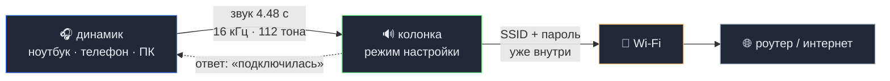
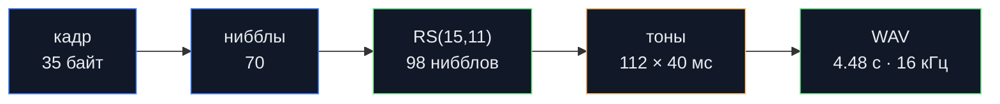

# Сопряжение Яндекс Станции с Wi-Fi — без приложения и серверов

Полностью локальный способ отправить колонке SSID и пароль Wi-Fi: **звуком**.
Ни аккаунта, ни облака, ни рута, ни установки приложения. Достаточно динамика
рядом с колонкой.

В репозитории — разобранный акустический протокол, разобранный BLE-канал
(и объяснение, почему он не подходит), готовые инструменты и приложение.

```
┌──────────────┐   звук 4.5 с   ┌────────────────┐   Wi-Fi   ┌─────────┐
│ ноутбук /    │ ─────────────► │    колонка     │ ────────► │  роутер │
│ телефон / ПК │  16 кГц, FSK   │ (режим настр.) │           │         │
└──────────────┘                └────────────────┘           └─────────┘
```



### Конвейер кодирования




---

## Быстрый старт

```bash
pip install numpy sounddevice

# один раз проиграть код
python tools/pair_by_sound.py --ssid "YaRig" --password "11111111"

# или: играть, пока колонка не появится в сети (сам подберёт громкость)
python tools/provision.py --ssid "YaRig" --password "11111111"
```

Колонка должна быть в режиме настройки (новая, сброшенная или перезапущенная
в режиме настройки). Подробности — [`docs/03-practice.md`](docs/03-practice.md).

Другие способы:

| Что | Файл |
|---|---|
| Графическое приложение (Windows/Linux/macOS) | `tools/provision_gui.py` |
| Веб-приложение для телефона (один HTML-файл) | `tools/sound_code.html` |
| Android APK (офлайн, без разрешений) | `android/SoundCode.apk` |

---

## Что проверено на живом устройстве

| Факт | Значение |
|---|---|
| Модель | Yandex Station Mini 2 (`YNDX-00020`) |
| Прошивка | `0.369.1.46.4778262943.20261013.299` |
| Кадр `YaRig` / `11111111` | `02055961526967083131313131313131106c6f63616c7061697230303030303030a86a` |
| Акустический приём | подтверждён логом: `Successful parsing: Credentials{ SSID='YaRig' }` |
| Рабочая громкость | 0.5 от полной шкалы |
| Длительность кода | 4.48 с (112 тонов) |
| BLE-канал | шифруется на ключ устройства (TEE), открытый текст не принимается |

Самое интересное наблюдение: **токен активации колонка не проверяет** на этом
шаге — подходит любая строка, например `localpair0000000`. Поэтому весь процесс
не требует облака.

---

## Как это работает

Коротко: кадр с учётными данными кодируется Ридом–Соломоном над GF(16) и
передаётся тонами по 40 мс: `1024 + ниббл*256` Гц.

```
кадр:  [тип][len SSID][SSID][len пароль][пароль][len токен][токен][crc32]
RS:    блоки 11+4 ниббла, GF(16), полином 0x13
эфир:  6192,6192,5120,5120 | версия,контроль | данные | 5632 × 8
```

Полное описание: [`docs/01-sound-protocol.md`](docs/01-sound-protocol.md).

---

## BLE: почему не он

BLE-канал мы тоже разобрали полностью (GATT-карта, формат кадров, конверт
`{"ciphertext":…,"M":…,"C":…}`). Но учётные данные шифруются на **ключ конкретного
устройства**, который живёт в защищённой среде (`keymaster`/TEE) и не экспортируется.
Открытый текст BLE не принимает ни в одной характеристике.

Итог: BLE годится только для воспроизведения ранее полученного конверта на том же
устройстве, а не для локальной настройки. Подробности и все проверки:
[`docs/02-ble-protocol.md`](docs/02-ble-protocol.md).

---

## Структура

```
docs/
  01-sound-protocol.md   полный разбор акустического протокола
  02-ble-protocol.md     BLE: GATT, кадры, шифрование, почему не подходит
  03-practice.md         как пользоваться, громкость, типовые проблемы
  04-scope.md            границы проекта, безопасность, правовое
tools/
  sound_protocol.py      кодер/декодер и генератор WAV
  pair_by_sound.py       CLI: сгенерировать и проиграть
  provision.py           автопровижининг с определением успеха
  provision_gui.py       графическое приложение
  sound_code.html        веб-версия для телефона
  test_frame.py          самопроверка (векторы + паритет JS/Python)
android/
  SoundCode.apk          готовое приложение
  src/…                  исходники (WebView)
  build_apk.ps1          сборка без Android SDK
  fetch_tools.py         скачивание инструментов сборки
examples/
  frame-yarig.hex        пример кадра
  tones-yarig.txt        полная последовательность частот
```

---

## Самопроверка

```bash
python tools/test_frame.py
```

Проверяет известный кадр, структуру тонов, обратный разбор и совпадение
Python- и JavaScript-реализаций (если установлен `dukpy`).

---

## Чего здесь нет

Репозиторий намеренно **не** содержит подмены трафика, эмуляции облака,
регистрации в аккаунте и получения root — это отдельная задача и отдельный
проект. Здесь только то, что нужно, чтобы колонка подключилась к Wi-Fi.

---

## Лицензия

MIT. Товарные знаки принадлежат их владельцам; проект не аффилирован с вендором.
Используйте на своих устройствах.
