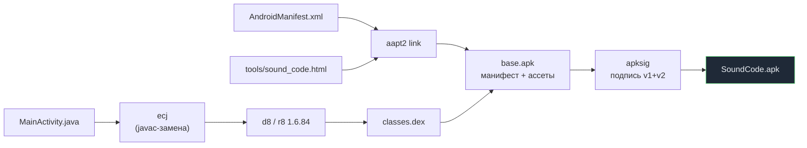

# Android-приложение «Звук сопряжения»

Офлайн-приложение: WebView + та же HTML-страница, что в `tools/sound_code.html`.
Ни интернета, ни разрешений, ни аналитики. Размер APK — ~17 КБ.

## Готовый APK

`SoundCode.apk` — можно сразу ставить на телефон (Android 4.1+).
При установке разрешите «установку из неизвестных источников».

## Сборка из исходников

Нужна только **JRE 8+** (javac и Android SDK не требуются).

```powershell
python fetch_tools.py       # ≈33 МБ: aapt2, d8/r8, android.jar, apksig, ecj
powershell -File build_apk.ps1
```

Как это работает без SDK и Gradle:



Почему именно такие версии:

| Инструмент | Почему |
|---|---|
| `ecj 3.26.0` | компилирует Java 8 и сам работает на JRE 8 |
| `r8 1.6.84` | последняя версия D8, собранная под Java 8 (новые требуют Java 11) |
| `aapt2 8.1.0` | линкует манифест и ассеты без SDK |
| `apksig 8.1.0` | подпись v1+v2 без `apksigner` и keystore (ключ в PEM) |

`targetSdkVersion=29` выбран специально: Android 11+ требует подпись v2 для
приложений с `targetSdk 30+`, а v2 здесь есть, но 29 оставляет совместимость
со старыми прошивками.

## Структура

```
AndroidManifest.xml              minSdk 16, targetSdk 29, без разрешений
src/com/rig/soundcode/MainActivity.java
signer/Signer.java               подпись через apksig (PEM-ключ)
fetch_tools.py                   скачивание инструментов в .tools/
build_apk.ps1                    сборка одной командой
SoundCode.apk                    готовый артефакт
```

## Что делает приложение

Открывает локальную страницу `file:///android_asset/index.html` в WebView:

* поля SSID/пароль/тип сети/токен;
* ползунок громкости;
* воспроизведение и повтор каждые 10 секунд;
* сохранение WAV.

Звук стартует без дополнительного «нажмите, чтобы разрешить» —
`setMediaPlaybackRequiresUserGesture(false)` вызывается через рефлексию,
чтобы код собирался под старый `android.jar`.
