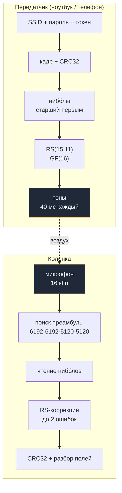
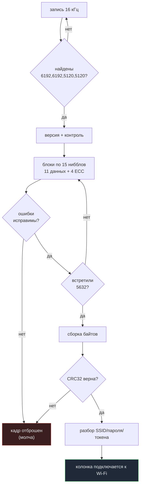

# Звуковой протокол сопряжения

Канал: **акустический**, динамик → микрофон колонки.
Назначение: передать SSID/пароль Wi-Fi колонке, которая ещё не в сети и не имеет
доступа к облаку. Ни приложения, ни сервера, ни рута не требуется.

Ниже — полное описание формата, восстановленное по логам самой колонки и проверенное
на живом устройстве (Station Mini 2, прошивка `0.369.1.46`).




---

## 1. Физический уровень

| Параметр | Значение |
|---|---|
| Частота дискретизации | 16 000 Гц |
| Длительность символа | 40 мс (640 сэмплов) |
| Модуляция | одна синусоида на символ (FSK-подобная, 16 значений) |
| Шаг частот | 256 Гц |
| Базовая частота | 1024 Гц |

Таблица данных: `f = 1024 + nibble * 256`, где `nibble` — 0…15.
Итого 1024, 1280, 1536, …, 4864 Гц.

Специальные тоны:

| Тон | Частота | Смысл |
|---|---|---|
| старт | 6192, 6192, 5120, 5120 | преамбула (4 символа) |
| версия | 1024 + version·256 | в известных прошивках `version = 0` |
| контроль версии | 1024 + checksum·256 | в известных прошивках `0` |
| конец | 5632 × 8 | маркер конца кадра |

> 6192 и 5120 не попадают в таблицу данных — по ним декодер находит начало.

### Как выглядит сигнал во времени

```
0 мс                                                              4480 мс
│                                                                       │
│◄─── преамбула ───►│◄─ вер. ─►│◄────────── данные ──────────►│◄ конец ►│
│ 6192 6192 5120 5120│ 1024 1024│ 98 тонов по 40 мс             │5632 × 8 │
└────────────────────┴──────────┴───────────────────────────────┴─────────┘
      160 мс            80 мс              3920 мс                320 мс
```

Каждый «столбик» — один тон длиной 40 мс; высота столбика соответствовала бы частоте:

```
частота
4864 ┤                            █
4608 ┤                          █ █ █
4352 ┤                        █ █ █ █
 ... │        · · · · · · · · · · · · · · · · · ·
1536 ┤            █   █
1280 ┤          █ █ █ █
1024 ┤      █ █ █ █ █ █ █   ← версия и данные
 512 ┤
     └──────────────────────────────────────────► время
       ▲   ▲                     ▲            ▲
   6192 5120                 данные       5632×8 (конец)
```


---

## 2. Кадр

```
+--------+----------+--------+-----------+--------+-----------+--------+-------+---------+
| 1 байт | 1 байт   |  N     | 1 байт    |   M    | 1 байт    |   K    | 2 байта |
|  тип   | len SSID |  SSID  | len пароля| пароль | len токена| токен  |  CRC32  |
+--------+----------+--------+-----------+--------+-----------+--------+-------+---------+
```

* Все строки — UTF-8, длина — **в байтах**, один байт (максимум 255 байт).
* CRC32 — от всех предыдущих байт, берутся младшие 16 бит, little-endian:
  `crc = zlib.crc32(buf) & 0xFFFF`, затем `crc & 0xFF`, `crc >> 8`.

### Типы сети

| Тип | Смысл | Содержимое |
|---|---|---|
| `2` | WPA/WPA2, обычная сеть | `[2][len SSID][SSID][len пароль][пароль]` |
| `4` | скрытая сеть | `[4][hashCode(SSID) as int16 LE][len пароль][пароль]` |
| `5` | открытая сеть | `[5]` (без SSID и пароля) |

Для скрытой сети вместо имени передаётся `java.lang.String.hashCode(SSID) % 32767`
(знаковое 16-битное little-endian).

Далее в любом случае идёт `[len токена][токен]` и CRC.

### Токен

Токен активации приходит из приложения/облака, но **колонка не проверяет его
содержимое на этом шаге** — подходит любая строка до 255 байт, например
`localpair0000000`. Это и делает протокол полностью локальным.

### Пример

SSID `YaRig`, пароль `11111111`, токен `localpair0000000`:

```
02 05 5961526967 08 3131313131313131 10 6c6f63616c7061697230303030303030 a86a
│  │  └ YaRig     │  └ 11111111     │  └ localpair0000000            └ CRC32
│  └ длина SSID    └ длина пароля    └ длина токена
└ тип = WPA
```

Итоговый кадр (35 байт):

```
02055961526967083131313131313131106c6f63616c7061697230303030303030a86a
```

Раскладка по байтам:

```
смещение │  0 │  1 │ 2 … 6        │  7 │ 8 … 15        │ 16 │ 17 … 32          │ 33 34
байт     │ 02 │ 05 │ 59 61 52 69 67│ 08 │ 31 31 31 31 … │ 10 │ 6c 6f 63 61 …    │ a8 6a
поле     │тип │len │ "YaRig"      │len │ "11111111"    │len │ "localpair…"     │ CRC32
         │WPA │SSID│              │пар.│               │ток.│                  │  LE
```

```
┌────┬────┬──────────┬────┬────────────┬────┬──────────────┬──────────┐
│ 02 │ 05 │  YaRig   │ 08 │ 11111111   │ 10 │ localpair…   │  CRC32   │
└────┴────┴──────────┴────┴────────────┴────┴──────────────┴──────────┘
  ▲    ▲       ▲        ▲        ▲        ▲         ▲            ▲
 тип  длина  SSID     длина   пароль    длина     токен      2 байта LE
```


---

## 3. Помехоустойчивое кодирование

Кадр разбивается на **нибблы** (старший полубайт первым) и кодируется
Ридом–Соломоном над GF(16):

| Параметр | Значение |
|---|---|
| Поле | GF(2⁴), образующий полином `x⁴ + x + 1` (`0x13`) |
| Длина блока | 15 нибблов |
| Данные | 11 нибблов |
| Чётность | 4 ниббла (ECC) |
| База генератора | 1 (корни α¹…α⁴) |
| Исправляет | до 2 ошибок на блок |

Блоки идут подряд по 11 данных + 4 ECC. **Последний блок может быть неполным**:
в нём просто меньше данных, но по-прежнему 4 ECC. Например, кадр 35 байт = 70 нибблов:

```
70 = 6 * 11 + 4       →  6 полных блоков (66 нибблов) + блок из 4 данных и 4 ECC
итого в эфире: 6*15 + 8 = 98 нибблов
```

Именно поэтому итоговая длина не кратна 15 — это нормально и так задумано.

```
кадр: 70 нибблов
┌──────────────────────────┬──────────────────────────┬─────┬──────────────────────────┐
│ блок 1                   │ блок 2                   │ …   │ блок 7 (неполный)        │
│ 11 данных │ 4 ECC        │ 11 данных │ 4 ECC        │     │  4 данных │ 4 ECC        │
└──────────────────────────┴──────────────────────────┴─────┴──────────────────────────┘
     15 нибблов                 15 нибблов                     8 нибблов
в эфире: 6 × 15 + 8 = 98 нибблов = 98 тонов по 40 мс
```

Схема коррекции: в каждом блоке 11 полезных нибблов и 4 проверочных,
поэтому декодер может исправить до двух испорченных нибблов **в блоке**.
Ошибки в разных блоках не складываются — каждый блок исправляется отдельно.


> Практическое следствие: ECC всего 4 ниббла. Если звук искажён (клиппинг), ошибок
> становится больше двух на блок, и колонка отбрасывает кадр **молча** (в логе видно
> `reed_solomon_decoder.cpp: Error locator degree does not match number of roots`).

---

## 4. Полная последовательность

```
[6192, 6192, 5120, 5120]          преамбула
[1024 + version*256, 1024 + checksum*256]   версия канала
[ 98 нибблов после RS ]           полезная нагрузка
[5632 × 8]                        конец
```

Для примера выше: `4 + 2 + 98 + 8 = 112` символов → **4.48 секунды**.

Порядок тонов для примера лежит в [`examples/tones-yarig.txt`](../examples/tones-yarig.txt).

---

## 5. Как это декодируется (для понимания)

1. Запись 16 кГц, поиск четырёх подряд тонов 6192, 6192, 5120, 5120.
2. Следующие два символа — версия и её контрольное значение.
3. Далее символы читаются блоками по 15: первые 11 — данные, 4 — ECC;
   ошибки исправляются, при неудаче блок/кадр отбрасывается.
4. Символы 5632 означают конец.
5. Из данных собираются байты, проверяется CRC32 (младшие 16 бит), разбираются поля.




Колонка делает то же самое; в её логах это выглядит так:

```
sound_utils.cpp:120          Protocol version candidate: 0
sound_data_receiver.cpp:196  Source protocol version is: 0
setup_endpoint.cpp:285       Successful parsing: Credentials{ wifiType=WPA, SSID='YaRig', ... }
first_run_endpoint.cpp:186   Got credentials with id: ...
```

---

## 6. Почему формат именно такой

* **4 ECC-ниббла** — компромисс: кадр короткий, эфир шумный, но и 2 исправляемых
  ошибки на блок хватает, если уровень записи нормальный.
* **40 мс на символ** — при 16 кГц это 640 сэмплов: достаточно для уверенного
  измерения частоты, но кадр остаётся коротким (~4.5 с).
* **Токен без проверки** — сценарий «первичная настройка»: колонка ещё не знает
  аккаунт, поэтому доверяет любому токену.

---

## 7. Проверочные векторы

| Что | Значение |
|---|---|
| Кадр `YaRig`/`11111111`/`localpair0000000` | `02055961526967083131313131313131106c6f63616c7061697230303030303030a86a` |
| Нибблов в кадре | 70 |
| Нибблов после RS | 98 |
| Всего тонов | 112 |
| Длительность | 4.48 с |
| hashCode(`YaRig`) % 32767 | 3823 (для типа 4) |

Проверка: `python tools/test_frame.py` (включая паритет с JS-версией).
