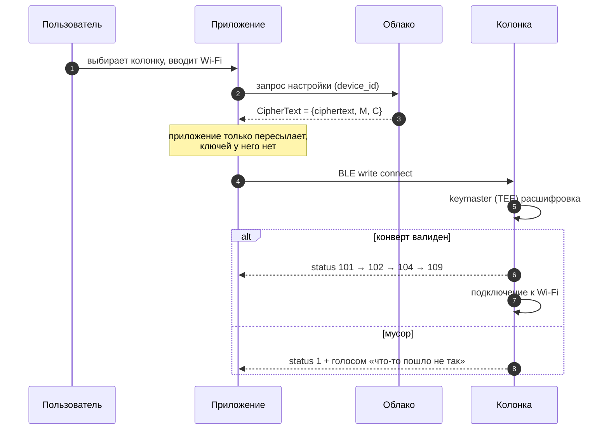
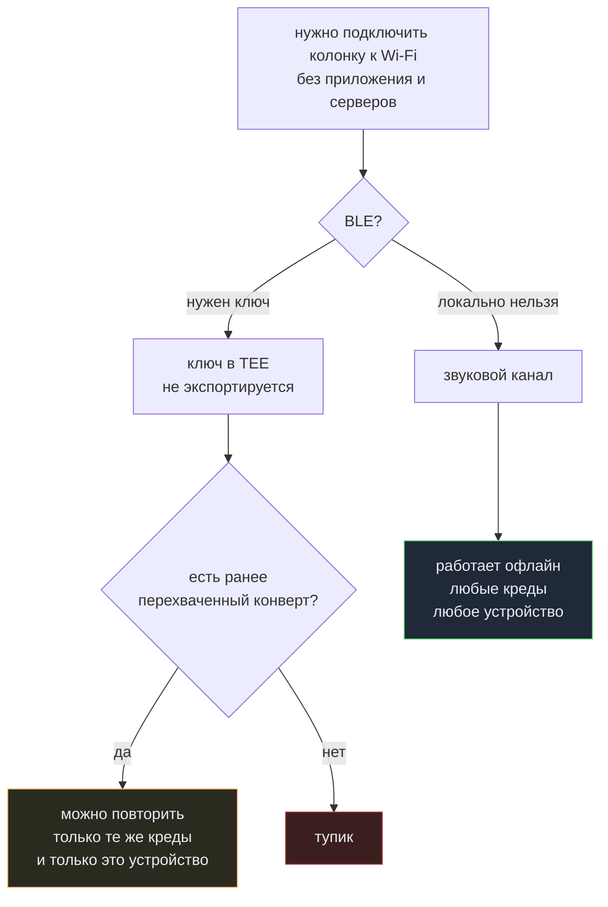

# Bluetooth (BLE) протокол настройки

Этот документ описывает BLE-канал, который использует официальное приложение.
Мы разобрали его полностью — включая формат кадров и то, **почему его нельзя
использовать для полностью локального сопряжения**, в отличие от звука.

Всё ниже проверено на Station Mini 2 (`YNDX-00020`).




---

## 1. Реклама и GATT

В режиме настройки колонка рекламирует сервис:

```
664578b6-c390-42d8-956e-c1ae8b646436
```

Характеристики (карта снята с живого устройства):

| UUID | Свойства | Назначение |
|---|---|---|
| `4276d829-46ce-4ce9-9f30-30dbb9a43724` | read | `deviceId` |
| `e985aa00-e701-4d5d-96b9-f38ae3d7ee16` | read | список Wi-Fi сетей (`wifiList`) |
| `9879f69f-510f-4a0c-b500-79de90342997` | read, notify | статус настройки |
| `5b66e7df-1b0f-4a9d-8492-5c3f3b866c80` | write | токен / служебные данные |
| `29d49103-16f4-4fcd-85c7-42d0e43d16d9` | write | служебная запись |
| `f25d4a0d-6266-4254-943e-3e20606f2fa6` | write | `connect` — учётные данные |

Дополнительно в реальном сеансе приложения запись шла в характеристику
`a62f6f60-203e-3e94-5442-66620d4a5df2` (handle `0x00b8`) — она появляется
в GATT-базе в момент настройки.

---

## 2. Формат кадра

Все значения (кроме уведомлений) имеют общий заголовок:

```
[u8  версия = 0x01][u16  0x0000][u16  длина BE][payload]
```

Обратите внимание: **длина — big-endian u16**, а не один байт. На коротких
сообщениях это совпадает с наивной реализацией, на длинных — нет.

Примеры:

| Что | Байты |
|---|---|
| `deviceId` | `01 00 00 00 0e` + `M00GDW300XXXX` |
| `wifiList` | `01 00 00 01 60` + JSON-массив |
| статус | `00` + `{"status":101}` |

`wifiList` возвращает список видимых сетей:

```json
[{"secure":true,"signal":-20,"ssid":"YaRig"},
 {"secure":true,"signal":-60,"ssid":"Home"}]
```

Полезно для диагностики: если список читается, BLE-сервер жив и устройство
в режиме настройки.

---

## 3. Статусы настройки

Уведомления в характеристике `status`, формат `00` + JSON:

| status | Смысл |
|---|---|
| `101` | учётные данные приняты, идёт подключение к Wi-Fi |
| `102` | подключение к сети |
| `104` | устройство зарегистрировано |
| `107` | промежуточный этап |
| `109` | настройка завершена |
| `1` | ошибка |

После успеха в логе: `Stopping BLE server` — реклама выключается.

---

## 4. Характеристика `connect`

Сюда приложение пишет учётные данные. Что принимается:

| Отправлено | Реакция устройства |
|---|---|
| бинарный кадр (как в звуке) | `BadJson.SetupCredentials` — ждёт JSON |
| `{"ssid":...,"password":...}` | `InvalidSetupCredentialsFormat` |
| `{"ssid":...,"password":...,"xTokenCode":...}` | `InvalidSetupCredentialsFormat` |
| `{"wifi_ssid":...,"password":...,"xtoken":...}` | `InvalidSetupCredentialsFormat` |
| `{"plain":{...}}`, `{"credentials":{...}}`, `{"type":"plain"}` | `InvalidSetupCredentialsFormat` |
| **`{"ciphertext":"..."}`** | `Got encrypted setup credentials` |
| `{"ciphertext":"...","M":"...","C":"..."}` | то же (полный конверт) |

Открытый текст BLE **не принимает ни в одной** из трёх write-характеристик.
Открытый путь (`Got plaintext setup credentials`) есть только у звукового канала.

---

## 5. Настоящий конверт от приложения

При настройке через приложение в `connect` уходит JSON:

```json
{"ciphertext":"<base64, 32 байта>",
 "M":"<base64, 32 байта>",
 "C":"<base64, 256 байт>"}
```

Структура конверта:

```
┌──────────────────────────────────────────────────────────────────┐
│ connect: JSON                                                    │
│                                                                  │
│  ciphertext  32 Б  ──┐                                           │
│  M           32 Б  ──┼──► сессионные компоненты (ключ/имитовставка)│
│                      │                                           │
│  C          256 Б  ──┴──► RSA-2048 блок, шифруется на ключ       │
│                            конкретной колонки                   │
└──────────────────────────────────────────────────────────────────┘
                                │
                                ▼
                    keymaster (TEE, защищённая среда)
                                │
                     ┌──────────┴──────────┐
                     ▼                     ▼
              расшифровано            ошибка
              (SSID/пароль)       («что-то пошло не так»)
```


Размеры фиксированы: `C` — ровно блок RSA-2048, то есть схема гибридная:

* `C` — асимметричная часть (шифруется на ключ конкретной колонки);
* `ciphertext`, `M` — 32-байтные компоненты (ключ/имитовставка сессии).

SSID и пароль в трафике не встречаются ни в каком виде — проверено поиском
по hex.

### Где ключ

`C` расшифровывается **внутри защищённой среды устройства**. При повреждённом
конверте в логе:

```
keymaster_proxy_client.cpp:68  queryKeymaster failed: Keymaster error
setup_endpoint.cpp:112         Failed to decrypt credentials: Cannot decrypt ble credentials
```

То есть используется сервис `keymaster` (TEE), ключ:

* не лежит в файлах (`/data`, `/factory`, `/persist` — пусто);
* не выводится из `device_id` (устройство не отправляет публичный ключ при
  регистрации — тело запроса `/register` пустое);
* не экспортируется в пользовательское пространство.

Приложение тоже не шифрует: в APK есть только модели данных
(`ciphertext`, `M`, `C`, `ciphertextPubKey`, `hmac`), но нет кода шифрования —
конверт готовит облако директивой `TStartBleSetupDirective.CipherText`.

---

## 6. Что из этого следует




| Возможность | Итог |
|---|---|
| Настроить колонку по BLE «с нуля», без облака | **нельзя** — нужен ключ из TEE |
| Повторить (replay) ранее перехваченный конверт этой же колонки | **можно**, проверено: колонка подключается к той же сети |
| Подставить свой SSID/пароль | нельзя — они зашиты в шифртекст |
| Использовать BLE на другом устройстве | нельзя — ключ у каждого свой |

Реплей полезен как способ «перевыдать» той же колонке те же самые креды
(например, после сброса), но он требует один раз получить конверт от облака
и, как правило, доступа к устройству для его снятия. Для сценария
«подключить колонку к Wi-Fi без приложения и серверов» это не подходит.

**Вывод:** локальный канал сопряжения — звуковой. BLE у Яндекса спроектирован
как защищённый облачный канал, и обойти это без ключа из TEE нельзя.

---

## 7. Мелочи, которые пригодились

* Windows-стек BLE периодически рвёт линк на длинных записях
  (`WinError -2147483629`); помогает переподключение и
  `winrt={"use_cached_services": False}`.
* После записи полного конверта колонка отвечает статусами `101 → 102 → 104 → 109`
  и выключает рекламу.
* Если отправлять мусор в `ciphertext`, колонка голосом говорит «что-то пошло не так» —
  это не ошибка формата, а именно неудачная расшифровка.
